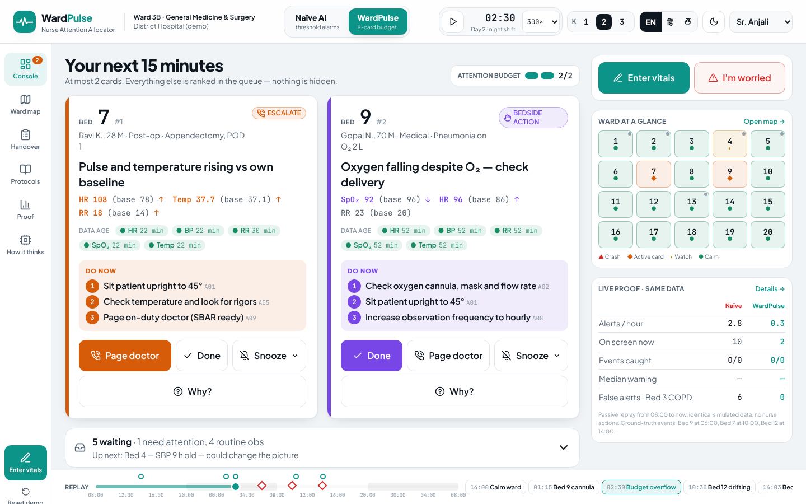
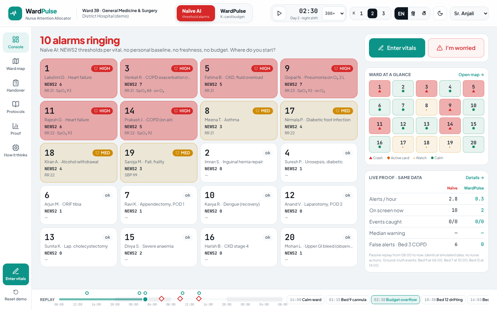
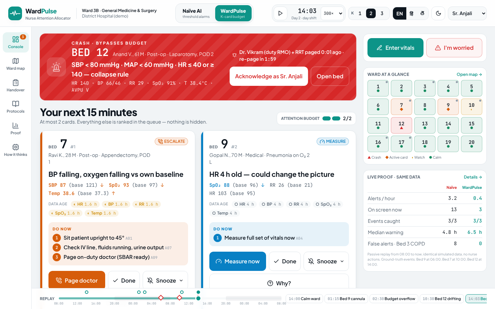

# WardPulse — Nurse Attention Allocator

> Other teams show 12 red alerts. WardPulse shows the 2 things the nurse should do right now — and proves it with a toggle.

Healthcare PS1 (early warning for patient deterioration), built for understaffed general wards where vitals are charted by hand every 4–6 h. WardPulse turns that sparse data into **at most K = 2 task cards**. Collapse vitals skip the queue as a **crash bypass** banner.



| Naïve AI (same data) | Crash bypass |
|---|---|
|  |  |

## Run it

```bash
cd web
npm install
npm run dev        # http://localhost:5173
npm run build      # static build in web/dist
```

The app needs no backend. The whole ward, including a seeded 20-bed simulator and the scoring engine, runs in the browser, so the demo works offline on one laptop.

## What's in the foundation

| Screen | What it does | Design-doc ref |
|---|---|---|
| **Console** | Crash banner slot, K cards (the ESCALATE, BEDSIDE ACTION and MEASURE types), standby queue, budget meter, "I'm worried", and a live proof strip comparing both modes | §11.1, §11.2, UC-1…6 |
| **Naïve ↔ WardPulse toggle** | The same ward rendered as a wall of NEWS2 threshold alarms. Toggling animates the tiles collapsing into the 2 cards | §11.3, F10 |
| **Bed detail** | 24 h sparklines with a personal-baseline band, data-age chips, z-scores, "why" factors, NEWS2 breakdown and card history | §11.1 |
| **Quick vital entry** | Steppers pre-filled with the last value, an entry timer against the 15 s target, and "read from device" (sim). Saving re-scores the bed instantly | F11, UC-1 |
| **SBAR** | One-tap templated SBAR. The nurse previews it before a simulated send | F14, UC-6 |
| **Ward map** | Floor plan with a nurse station. Status uses glyph + word, never colour alone. Shows overdue-obs markers and nurse assignment | §11.1 |
| **Handover** | Auto-drafted from the audit log with event IDs. Editable, with sign-off, next to the full audit log | F15, F17, UC-7 |
| **Protocol assistant** | Retrieval-only answers with section citations. Says "not in protocol" when nothing matches and refuses drug/dose questions | F16, §8 |
| **Proof** | Alerts per nurse-hour, events caught, median warning time and false alerts on the COPD bed, for both modes. Includes a cumulative-alerts chart | §13 |
| **How it thinks** | The 6-layer architecture running live for any bed: baseline, z, staleness, risk, uncertainty, crash rules, the priority formula, rank, the worded card and where it's delivered | §5, §9 |

Also included: a replay timeline (scrub 48 h, play at 60–1800×) with story-beat jump points and ground-truth event markers, a K = 1/2/3 switch, EN/हिं/తె labels, a day/night-shift theme, and snooze-with-reason / flag-as-wrong feedback (UC-8).

### Demo script (2 min, matches §15.3)

1. Start on **Naïve AI** (≈10 alarms at 02:30). Toggle to **WardPulse**: the tiles collapse into 2 cards.
2. **Bed 7** (post-op, RR 18 / HR 108 vs his own baseline of 14 / 78) gets ESCALATE. **Bed 3** (COPD, RR 22 / SpO₂ 88 every day) stays quiet.
3. Click **Done** on Bed 9 (cannula). **Bed 4 MEASURE** ("SBP 9 h old") is promoted from standby. Click Measure now → Read from device → Save, and the card closes.
4. Jump to the **Bed 12 crash** beat. The red banner appears above the budget and the doctor and RRT are paged. Acknowledge it.
5. Open **Proof**: 0.5 vs 3.1 alerts/hour, 0 vs 12 false alerts on Bed 3, and a median warning of 6.5 h vs 4.75 h over 48 h.

## Code map (`web/src`)

```
config/      vitals.js · crashRules.js · catalogue.js (A01–A11, en/hi/te) · engine.js (K, thresholds, weights)
sim/         scenario.js (20 beds, scripted Beds 3/4/7/9/12/13, ground-truth events) · ward.js (seeded generator)
engine/      baseline.js (median/MAD, z, slope) · news2.js · crash.js · score.js (risk, uncertainty, factors)
             prioritise.js (candidate tasks, priority, K budget, cool-down, hysteresis) · pipeline.js (runWard, replay, metrics)
             narrative.js (templated SBAR + handover — the LLM-off fallback)
data/        adapter.js (where real datasets / the API plug in) · protocols.js (demo SOP corpus + retrieval)
store/       WardContext.jsx (clock, mode, nurse event log → pure re-score)
components/  TaskCard · CrashBanner · VitalEntry · BedDetail · SbarModal · Sparkline · Shell (header, nav, timeline)
screens/     Console · WardMap · Handover · Assistant · Proof · Engine
```

`runWard(ward, now, events)` is a **pure function**: the console, map, metrics and replay are all derived from (data, clock, nurse actions). Because of that, scrubbing, the mode toggle and the passive-replay metrics stay consistent.

## Plugging in the real pieces

| Stub today | Replace with | Where |
|---|---|---|
| Seeded simulator | Python simulator / sparsified PhysioNet 2019 export as `web/public/data/ward.json` | `data/adapter.js` documents the JSON shape (`fromScenarioJson`) |
| `riskModel()`, a transparent logistic heuristic | Calibrated LightGBM + SHAP served by FastAPI | `engine/score.js` (output contract: `{risk, uncertainty, crashFlag, factors}`) |
| In-browser orchestration | FastAPI `/ward/{id}/console` and WS `/ws/ward/{id}` | `vite.config.js` already proxies `/api` → `:8000` |
| Templated SBAR / handover | LLM rephrasing behind the number/catalogue validator | `engine/narrative.js` |
| Keyword retrieval over demo SOPs | Hybrid BM25 + bge-m3 → FAISS → re-rank → cited LLM answer | `data/protocols.js` |

**Caveats.** The protocol texts are placeholders written for the demo. The thresholds are illustrative and need clinician sign-off. The Hindi and Telugu strings are drafts to verify with native speakers. All patient data is simulated.
